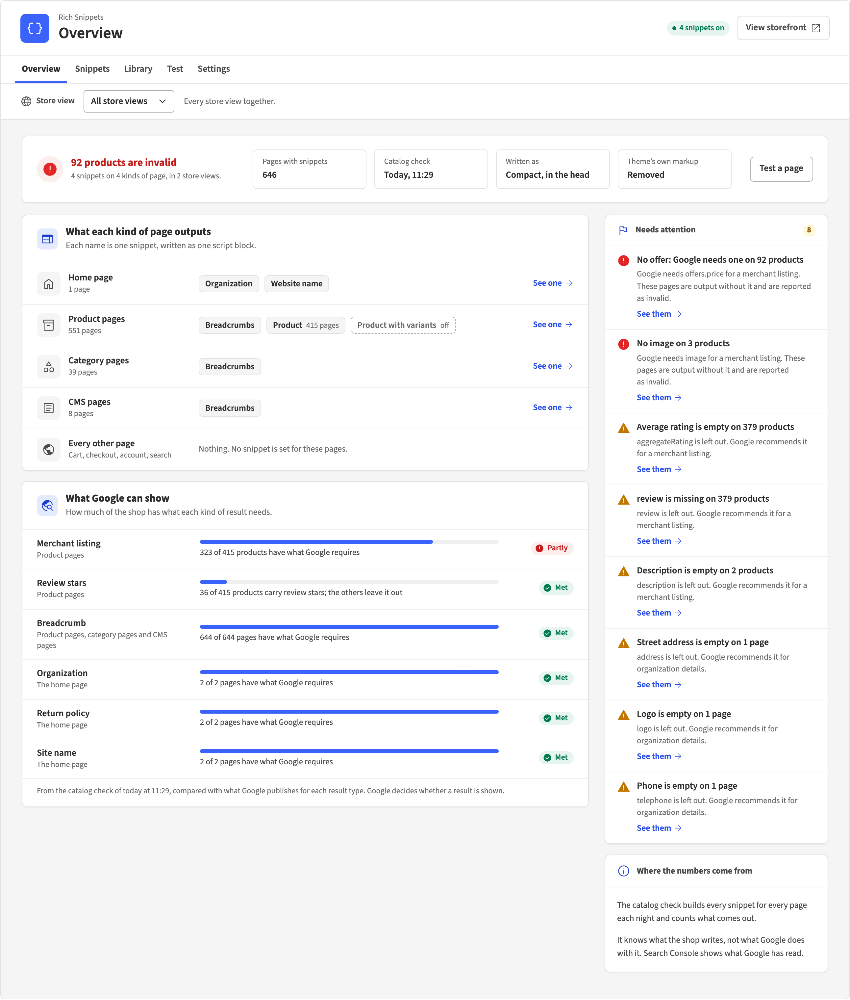
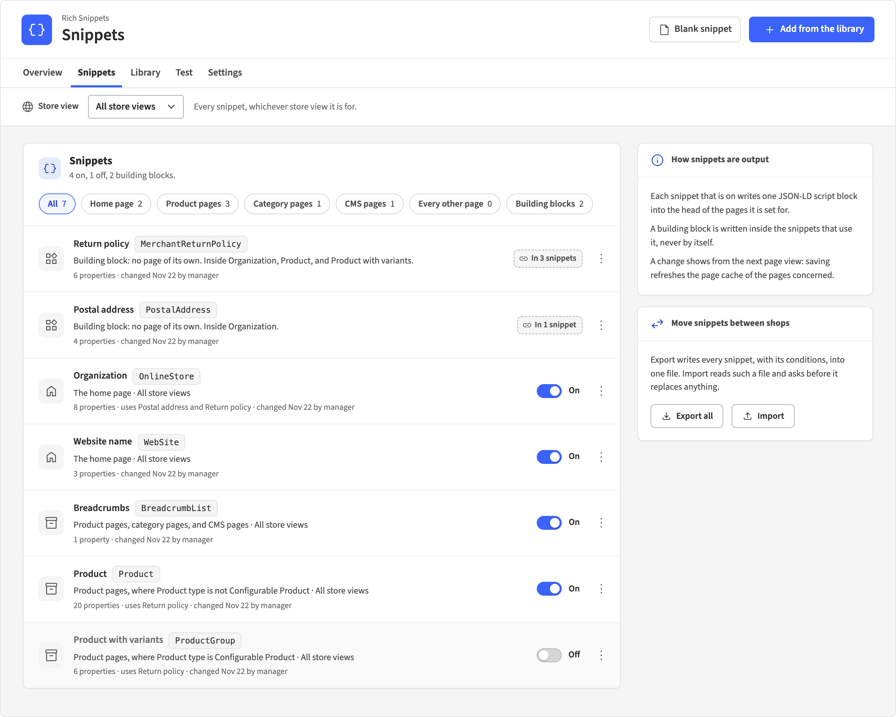
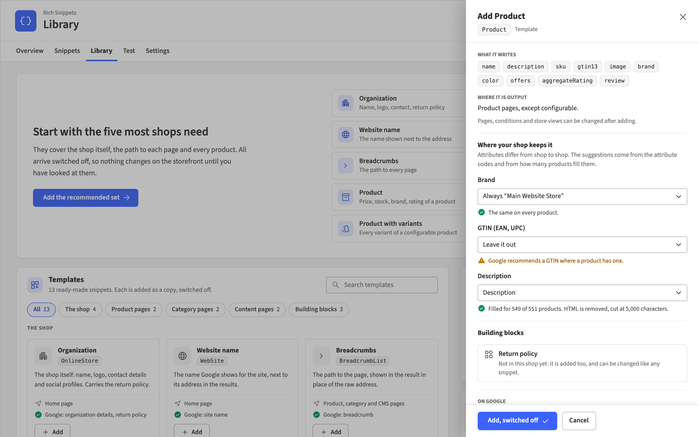
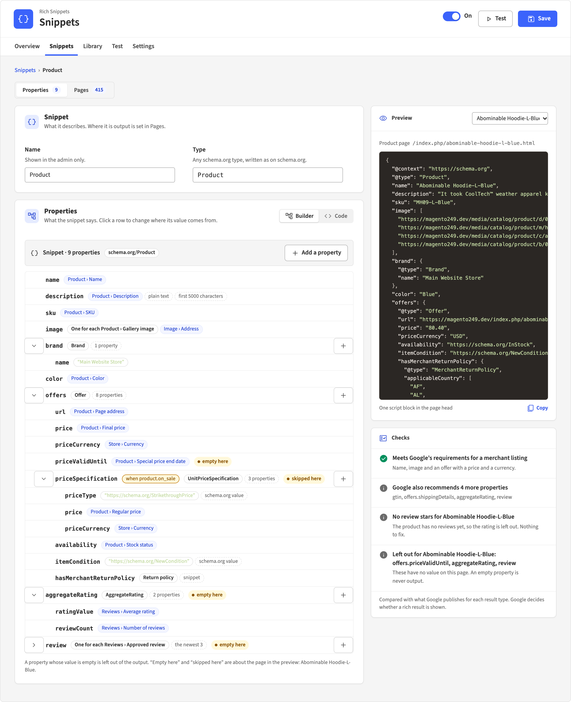
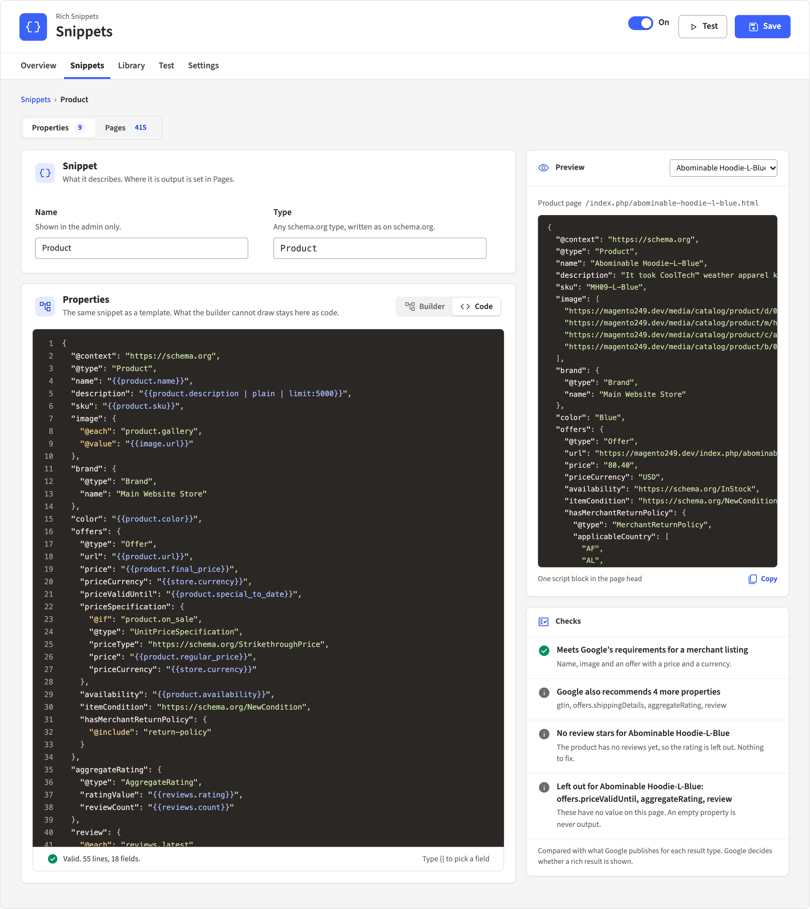
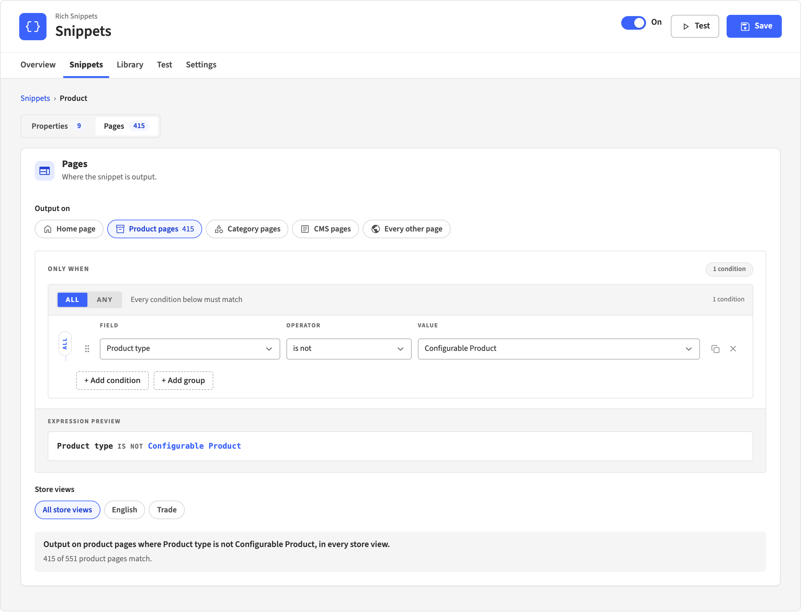
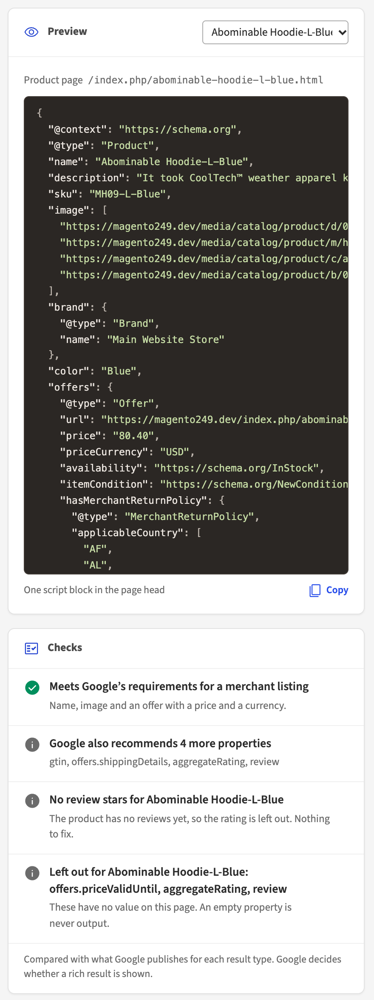
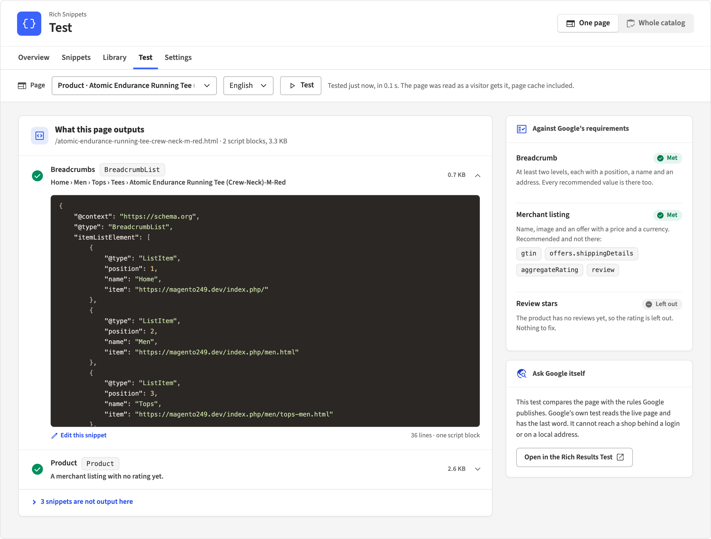
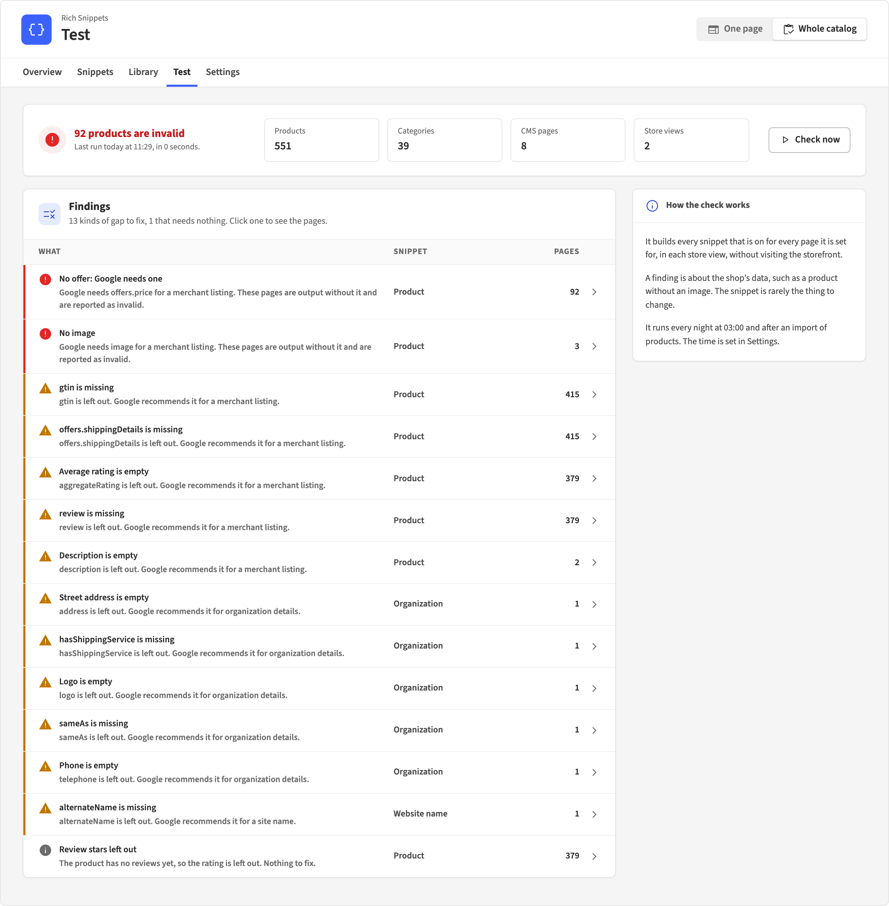

# Rich Snippets for Magento 2

Rich Snippets writes JSON-LD structured data into your storefront pages, so search engines can show rich results for
your shop: product price and stock, review stars, breadcrumbs, the shop's name and logo, return and shipping policies.

Each snippet is a JSON template. A template names the schema.org type it describes and takes its values from your
catalog. You write a template in a visual builder or as code, choose the pages and store views it applies to, and
switch it on. The module checks every snippet against what Google requires for each kind of result. It tests a single
storefront page as a visitor sees it. Each night it checks the whole catalog and lists the products that have gaps.

A library of 13 ready-made templates gets a shop started. It includes Organization, Website name, Breadcrumbs, Product
and Product with variants.



## What is in the box

- **JSON-LD output** in the head or at the end of the body, printed by the server into the page that the full-page
  cache stores. The storefront loads no JavaScript for it.
- **Templates as data.** Strings hold `{{ expressions }}`. Objects hold directives such as `@if`, `@each` and
  `@include`. An empty value drops out of the output by itself.
- **Placement** by kind of page (home, product, category, CMS, every other page), by conditions on the page's data, and
  by store view.
- **Prices a visitor sees.** A price in a snippet is the price in the visitor's customer group and display currency.
- **Variant addresses.** A product with variants lists each variant under its own address. The address opens the page
  with that variant chosen.
- **A requirements check.** It compares each snippet with Google's required and recommended properties for each kind of
  result. The rules are JSON files, so a change on Google's side is a data update.
- **A page test and a catalog check.** The page test reads one storefront page. The catalog check builds every snippet
  for every page without visiting the storefront.
- **Export and import** of snippets between shops, with a preview before anything is written.
- **Extension points** for fields, lists, conditions, requirement rules, library templates, output positions and
  Overview items.

## Requirements

- Magento Open Source or Adobe Commerce 2.4. The module is developed and checked on 2.4.9.
- PHP 8.2, 8.3, 8.4 or 8.5.
- Cron must run. The module's jobs are in their own cron group, `hryvinskyi_rich_snippets`, which runs in a separate
  process.

Composer installs these packages with the module:

| Package | Module | What the module uses it for |
|---|---|---|
| `hryvinskyi/magento2-json-template` | `Hryvinskyi_JsonTemplate` | The template engine: compiler, evaluator, filters and the compiled-template cache. |
| `hryvinskyi/magento2-admin-ui` | `Hryvinskyi_AdminUi` | The admin pages' look, their header, tabs and store-view bar, and the code editor. |
| `hryvinskyi/magento2-ui-form-elements` | `Hryvinskyi_UiFormElements` | The expression builder behind **Only when**. |
| `hryvinskyi/magento2-head-tag-manager` | `Hryvinskyi_HeadTagManager` | Writes the script blocks into the head. |
| `hryvinskyi/magento2-base` | `Hryvinskyi_Base` | The shared **Hryvinskyi Extensions** configuration tab. |
| `hryvinskyi/magento2-admin-setup-wizard` | `Hryvinskyi_AdminSetupWizard` | The JSON answer format that the admin endpoints share. |

## Installation

Run the commands from the Magento root.

```bash
composer require hryvinskyi/magento2-rich-snippets
bin/magento module:enable Hryvinskyi_RichSnippets Hryvinskyi_JsonTemplate Hryvinskyi_AdminUi Hryvinskyi_UiFormElements Hryvinskyi_HeadTagManager Hryvinskyi_Base Hryvinskyi_AdminSetupWizard
bin/magento setup:upgrade
bin/magento setup:di:compile  # production mode only
bin/magento setup:static-content:deploy -f  # production mode only
bin/magento cache:flush
```

To install by hand, place the module in `app/code/Hryvinskyi/RichSnippets` and install the packages in the table above
the same way. Then run the `module:enable` command and the commands after it.

`setup:upgrade` creates the module's tables and turns on its cache type, **Rich Snippets**. The JSON Templates cache
type comes from the template engine package. Both types must stay enabled in production.

After the upgrade, open **Marketing** > **SEO & Search** > **Rich Snippets**.

### What the module stores

| Table | Holds |
|---|---|
| `hryvinskyi_rich_snippets_snippet` | The snippets: template, page kinds, conditions, store views, switch. |
| `hryvinskyi_rich_snippets_idempotency` | The result of each creating write, so a repeated request answers the first result. |
| `hryvinskyi_rich_snippets_observation` | What the last page test saw of the theme's own microdata, per store view and kind of page. |
| `hryvinskyi_rich_snippets_check_run` | Catalog checks: requested, running or finished. |
| `hryvinskyi_rich_snippets_check_finding` | The gaps a check found, per store view. |
| `hryvinskyi_rich_snippets_check_finding_item` | The pages behind each gap, for the latest finished check and the running one only. |
| `hryvinskyi_rich_snippets_check_aggregate` | The counts of a check, per store view. |

The module has no uninstall script. Removing the module leaves these tables and the settings under
`hryvinskyi_rich_snippets/` in place.

## Admin tour

The module's pages are under **Marketing** > **SEO & Search** > **Rich Snippets**. They share one header and five
tabs: **Overview**, **Snippets**, **Library**, **Test** and **Settings**. **Settings** opens the module's configuration
section.

### Overview

The Overview tells you whether the snippets work and what needs attention. A bar at the top picks a store view, or all
store views together. The page shows:

- the state: **Live**, off, or nothing set up yet, with the number of snippets, the kinds of page and the store views;
- four facts: the pages with snippets, whether the catalog check has run, how the snippets are written (compact or
  readable, in the head or at the end of the body) and whether the theme's own markup is removed;
- **What each kind of page outputs**: for each kind of page, the number of pages and the snippets written on them, with
  **See one** to open a sample page in **Test**;
- **What Google can show**: for each kind of Google result, whether the shop's pages meet its requirements, partly meet
  them or give no result, from the last catalog check;
- **Needs attention**: pages that Google would report as invalid, theme markup that duplicates a snippet, recommended
  values that are missing and library templates with a newer version.

**Test a page** opens the **Test** tab.

### Snippets



The list shows every snippet with its schema.org type, the pages it is output on, its store views and the number of
properties. Chips filter the list by kind of page. A switch turns a snippet on or off. A row menu duplicates, exports or
deletes a snippet.

A snippet can carry flags: a property that Google requires and no page can fill, a result Google no longer shows, two
snippets of one type on the same page, and findings of the last catalog check.

- **Blank snippet** opens the editor with an empty template.
- **Add from the library** opens the **Library** tab.
- **Export all** writes every snippet, with its conditions, into one file.
- **Import** reads such a file and shows what is new, changed or identical. For a snippet that exists already you
  choose **Replace**, **Keep both** or **Skip**. A condition that refers to a category or an attribute set travels by
  its name. The preview lists each one the target shop cannot resolve.

A copy, an import and a library template all arrive switched off.

A **building block** is a snippet with no page of its own. It has no switch. It is written only inside the snippets that
include it, and the list shows how many snippets use it. A snippet that other snippets include cannot be deleted. The
error names the snippets that use it.

### Library



The library holds 13 ready-made templates, grouped as **The shop**, **Product pages**, **Category pages**, **Content
pages** and **Building blocks**:

| Group | Templates |
|---|---|
| The shop | Organization, Website name, Breadcrumbs, Local business |
| Product pages | Product, Product with variants |
| Category pages | Product list, Category |
| Content pages | FAQ, Article |
| Building blocks | Return policy, Shipping policy, Postal address |

**Add the recommended set** adds five templates in one step: Organization, Website name, Breadcrumbs, Product and Product
with variants. Their building blocks come with them.

Adding a single template opens a dialog. It shows the properties the template writes and the pages where it is output.
It also asks where your shop keeps the data that differs from shop to shop: the brand, the GTIN, the description and the
social profiles. Each question offers suggestions from your catalog, with the share of products that fill each
attribute. The answer is written into the new snippet, which arrives switched off. When a template has a newer version,
the Overview says so. The library then adds the new version beside your copy and leaves your copy as it is.

### The editor

A snippet opens in the editor. The header holds the **On**/**Off** switch, **Test** and **Save**. The editor has two
tabs: **Properties** and **Pages**.

If someone else saved the same snippet first, **Save** is refused and the editor says so. Your changes stay on the
screen, and **Reload** shows the other version.

#### Properties



The **Properties** tab holds the snippet's name (shown in the admin only) and its schema.org type. The type is any
schema.org type, written as on schema.org. The properties are listed below as a tree. Click a row to change where its
value comes from, or use **Add a property**. A value can be:

- a **field** of your store: `Product › Name`, `Price and stock › Final price`, `Store › Currency`, or any product
  attribute;
- a **fixed value**;
- **text with fields**, such as `{{product.name}} by {{product.manufacturer}}`;
- a **list** that repeats an object, for example one item for each gallery image or each of the newest three reviews;
- another **snippet**, included by its code.

The builder never limits the types or property names you can write. A property whose value is empty is left out of the
output. For the page you pick in the preview, a row shows "empty here" or "skipped here" when its property has no value
on that page.

The same snippet is available as a template in the **Code** tab. The editor there colours keys, fields, directives and
strings, and it offers the store's fields when you type `{{`. What the builder cannot draw stays in the code as a code
row. A template that does not compile cannot be saved.



#### Pages



The **Pages** tab says where the snippet is output:

- **Output on**: the kinds of page. These are the **Home page**, **Product pages**, **Category pages**, **CMS pages** and
  **Every other page** (cart, checkout, account and search).
- **Only when**: optional conditions. The expression builder groups conditions with **ALL** or **ANY**, and each
  condition is a **Field**, an **Operator** and a **Value**. The fields are product attributes, **Attribute set**,
  **Category**, **Product type**, **Category page** and **CMS page**. The operators are *is*, *is not*, *is one of*, *is
  not one of*, *contains*, *does not contain*, *greater than*, *equals or greater than*, *less than* and *equals or less
  than*. An expression preview and a sentence such as "Output on product pages where Product type is not Configurable
  Product, in every store view" state the result. They also show how many pages match, for example "415 of 551 product
  pages match".
- **Store views**: **All store views**, or the store views you pick. When a store view is deleted, every snippet
  loses it. A snippet that was set for that store view alone is switched off and set for no store view, never for all
  of them: the list flags it, and it stays off until you pick a store view and save it.

A snippet that has no kind of page is output nowhere. The editor says so, and **Save** still works, so you can keep a
draft.

#### Preview and checks



Beside the builder or the code, **Preview** shows the JSON that the snippet writes for a sample page you pick, and
**Copy** copies it. **Checks** compares the output with Google's requirements for the result types the snippet covers.
It says whether the requirements are met, which recommended properties Google would like and which properties are left
out for this page. A missing requirement never blocks **Save**. The check compares your page with what Google
publishes for each result type. Google decides whether a rich result is shown.

### Test

The **Test** tab has two modes: **One page** and **Whole catalog**.

#### One page



Pick a page (a product, a category, a CMS page or the home page, or type a storefront path such as `/checkout/cart`),
pick a store view and click **Test**. The module reads the page over HTTP, as a visitor gets it, with the page cache included. It lists:

- **What this page outputs**: each JSON-LD block, attributed to its snippet, with its size and a link to **Edit this
  snippet**;
- **Against Google's requirements**: each result type, **Met** or **Not met**, with the required properties that are
  missing;
- the snippets that are **not output here**, each with the reason: it is switched off, it is set for other store views,
  it has no kind of page, it is set for other kinds of page, or its conditions are not met;
- the theme's own schema.org markup on the page, when it has any.

**Open in the Rich Results Test** opens Google's own tool. Google's test has the last word. It cannot reach a shop behind
a login or on a local address.

#### Whole catalog



The catalog check builds every active snippet for every page that exists, in every store view, without visiting the
storefront. It checks enabled products that are visible individually and are assigned to the store view's website, the
active categories under its root, the active CMS pages and the home page. It reports the gaps in your data: a product
without an image, a variant without a price, an empty brand. Each finding says how many pages have the gap and which
snippets wrote them. Click a finding to see the pages. **Download the list** saves them as a CSV file.

The check runs every night at the time set in **Settings**, and after each product import. **Check now** requests a run.
Cron starts it within a minute.

## Settings

The settings are under **Stores** > **Settings** > **Configuration** > **Hryvinskyi Extensions** > **Rich Snippets**.
The **Settings** tab of the module's pages opens the same section.

| Group | Setting (path) | Default | Scope | Effect |
|---|---|---|---|---|
| General | **Enabled** (`hryvinskyi_rich_snippets/general/enabled`) | Yes | Default, website, store view | **No** stops every snippet in the scope, whatever its own switch says. Nothing is deleted. |
| Output | **Write the Snippets** (`hryvinskyi_rich_snippets/output/position`) | In the head | Default, website, store view | **In the head** (`head`) or **At the end of the body** (`body_end`). Search engines read both places. The end of the body keeps the head short on pages with many snippets. |
| Output | **Format** (`hryvinskyi_rich_snippets/output/format`) | Compact | Default | **Compact** (`compact`) or **Readable** (`readable`). Readable adds line breaks and indentation, so pages get slightly larger. |
| Output | **Prices in Snippets** (`hryvinskyi_rich_snippets/output/price_tax`) | As the catalog shows them | Default, website | **As the catalog shows them** (`catalog`), **Including tax** (`incl`) or **Excluding tax** (`excl`). A catalog that shows prices both ways writes them including tax. |
| Theme Markup | **Remove the Theme's Own Product Markup** (`hryvinskyi_rich_snippets/theme/remove_product_markup`) | Yes | Default, website, store view | Takes the schema.org attributes of the items the page's snippets also describe, such as the product with its price and rating, out of the product page's HTML. Other items stay. Nothing visible changes. It acts only on product pages that output a Product or ProductGroup snippet. |
| Theme Markup | **Found on the Storefront** | Read-only | Default, website, store view | What the last page test saw in the theme's HTML. |
| Catalog Check | **Check the Catalog Every Night** (`hryvinskyi_rich_snippets/check/enabled`) | Yes | Default | Builds every snippet for every page and lists what is missing. |
| Catalog Check | **Start At** (`hryvinskyi_rich_snippets/check/time`) | `03:00` | Default | Hours and minutes on the 24-hour clock, in the admin's time zone. Shown when the nightly check is on. Saving writes the matching cron expression. |
| Catalog Check | **Send the Findings To** (`hryvinskyi_rich_snippets/check/email`) | Empty | Default | Optional. One e-mail after a check that finds a page Google would report as invalid. Separate several addresses with commas. The e-mail template is **Rich Snippets: Catalog Check Findings**. Shown when the nightly check is on. |
| Catalog Check | **Last Check** | Read-only | Default | Pages checked, invalid and with a gap, when the last check ran and how long it took, with a link to the findings on the **Test** tab. |
| Developer | **Mark Each Block in the Page Source** (`hryvinskyi_rich_snippets/developer/comments`) | No | Default | Writes an HTML comment with the snippet's code before each script block, for finding them in the source of a test store. |

Saving the settings cleans the cached pages of every store view that the save reaches.

## Permissions

Give a colleague access in **System** > **Permissions** > **User Roles**, under **Role Resources**.

| Resource (path in the Role Resources tree) | ID | Allows |
|---|---|---|
| **Marketing** > **SEO & Search** > **See the module** | `Hryvinskyi_RichSnippets::view` | Open the Overview, the snippet list, the Library, the editor and the Test page. Read the findings of the catalog check. The editor is read-only: it shows no preview and no checks, no count of matching pages and no field values of a sample page. |
| ... > **Change snippets** | `Hryvinskyi_RichSnippets::snippets` | Switch, create, save, duplicate, delete, export and import snippets. Add from the library. Preview a draft and see its checks, the sample pages, the count of matching pages, the field values of a sample page and the value suggestions of a condition: each of these reads the catalog for any template or condition it is sent. |
| ... > **Run tests** | `Hryvinskyi_RichSnippets::test` | Test a page and use **Check now**. Without this right the Test page opens on the findings, and the pages do not draw **Test a page**, **See one**, **Check now** or the **Test** buttons of a finding's pages. |
| **Stores** > **Settings** > **Configuration** > **Change the settings** | `Hryvinskyi_RichSnippets::config` | Open the module's configuration section. |

Every endpoint checks its permission again on the server.

## How the output works

### Which snippets a page gets

For each storefront page the module works out the kind of page: `home`, `product`, `category`, `cms` or `other`. A kind
owns the full action names of its requests. The CMS page that is the home page counts as `home` only.

A snippet is output on a page when all of these hold:

1. **Enabled** is **Yes** for the store view.
2. The snippet is switched on, and it is not a building block.
3. The page's kind is one of the snippet's kinds of page.
4. The page's store view is one of the snippet's store views.
5. The snippet's **Only when** conditions hold for the page.

Each snippet that qualifies writes one script block:

```html
<script type="application/ld+json" data-snippet="product">{"@context":"https://schema.org","@type":"Product", ...}</script>
```

`data-snippet` carries the snippet's code. A snippet that fails to compile or evaluate is logged once for each request
and left out. The page is never broken by a snippet. A snippet whose root is empty after pruning is not written. The JSON
is encoded so that no text in a value can close the script element.

### Position, format and store views

**Write the Snippets** decides the place. In the head, the Head Tag Manager writes the blocks after the whole page has
rendered. At the end of the body, the module's block prints them where it stands. That block is in the `before.body.end`
container of every storefront page. With **Mark Each Block in the Page Source** on, the comment
`<!-- rich-snippet: <code> -->` comes before each block.

A snippet carries its own store views. The settings for position, format and price tax follow the scopes in the table
above.

### Prices

A price in a snippet is the price the page shows to the visitor: the visitor's customer group and display currency, with
tax as **Prices in Snippets** says. Both come from the request's HTTP context, which is what the full-page cache keys a
page by. The module never reads the customer session or the cart. A guest, and a crawler, gets the guest price.

Each product type has its own price source. A simple, virtual or downloadable product gives its final price. A
configurable product gives its lowest price among the children that can be bought. A bundle or grouped product gives its
minimal price.

The preview, the page test's expected output and the catalog check run as a guest in the store view's default display
currency.

### Variants and preselection

The **Product with variants** template writes one `Product` for each variant of a configurable product, under a
`ProductGroup`. The variant's `url` is the product's address with one query parameter for each configurable attribute.
The parameter is the attribute code and its value is the option ID:

```text
https://shop.example/weekender.html?color=49&size=167
```

When a product page opens at such an address, it opens with that variant chosen. The module feeds the parameters into
Magento's own preselection of configurable options. An address must name an option for every configurable attribute,
and the combination must be a child that can be bought. Otherwise nothing is preselected and nothing fails. The page's
canonical address stays the product's address.

### The theme's own markup

The default theme and the themes built on it write their own Product markup into the product page. With a Product
snippet on, every product would be described twice. When **Remove the Theme's Own Product Markup** is **Yes**, a product
page that writes a snippet of the type `Product` or `ProductGroup` loses the theme's microdata items that its snippets
describe again:

- the theme's `Product` (or `ProductGroup`) item, with every property inside it and every item that is one of its
  properties, such as the offer, the rating and the reviews;
- the theme's items of any other type a snippet on the page is written as, for example a `BreadcrumbList` item when a
  breadcrumb snippet is output.

Every other item stays as the theme wrote it, for example an `Organization` item in a product description. The removal
runs on the finished page, in one pass over its HTML, before the full-page cache stores it. A product page that writes
no `Product` or `ProductGroup` snippet keeps all of the theme's markup, so no page is left without a description.

### Full-page cache and caches

The JSON-LD is part of the cached page. Every storefront page carries two cache tags for its store view:

- `rich_snippets_kind_<kind>_<store view ID>`, for example `rich_snippets_kind_product_1`;
- `rich_snippets_store_<store view ID>`.

When you save, switch, delete or import a snippet, the module cleans these tags once the change is committed. It cleans
the tags of each kind of page and store view the snippet reached, before and after the change. It also cleans them for
every switched-on snippet that includes it, directly or through others. The page then rebuilds on the next request. A
change in the settings cleans the store-view tag of every store view it reaches. The cleaning goes through Magento's
standard event for cache cleaning by tag, so it reaches the built-in page cache and any caching proxy that listens to
the event.

| Cache | Holds | Cleaned |
|---|---|---|
| **Rich Snippets** (`rich_snippets`) | A selection index for each store view: the switched-on snippets of each kind of page, in output order. A page needs no snippet query once the index is kept. Also the catalog's attribute fill counts for the library questions, and the definitions that the module reads from JSON files. | By a snippet change, for the store views it can alter. **Flush** in Cache Management cleans all of it. |
| **JSON Templates** (`json_template`) | The compiled form of each template, keyed by the hash of its source. | **Flush** in Cache Management. |

## The template language in brief

A template is a JSON document. This is a part of the Product template that the library ships:

```json
{
  "@context": "https://schema.org",
  "@type": "Product",
  "name": "{{product.name}}",
  "image": { "@each": "product.gallery", "@value": "{{image.url}}" },
  "offers": {
    "@type": "Offer",
    "price": "{{product.final_price}}",
    "priceCurrency": "{{store.currency}}",
    "priceSpecification": {
      "@if": "product.on_sale",
      "@type": "UnitPriceSpecification",
      "price": "{{product.regular_price}}"
    },
    "hasMerchantReturnPolicy": { "@include": "return-policy" }
  },
  "review": {
    "@each": "reviews.latest",
    "@limit": 3,
    "@type": "Review",
    "reviewBody": "{{review.text}}"
  }
}
```

- `{{ expression }}` reads a value, with optional filters: `{{ product.short_description | plain | limit:5000 }}`. A
  string that is exactly one expression keeps the value's type. A string that mixes text and expressions is empty if
  any expression is empty.
- `@if` keeps an object only when its expression is true. `@each` repeats an object for each item of a list. `@as` names
  the item, `@limit` limits the items kept, `@value` makes the object a plain value, and `@include` writes another
  snippet by its code.
- An empty value is left out with its key. `false` and `0` are not empty.
- A value is data. A product name that contains `{{ x }}` is written as that text.

The roots a template reads are `product`, `reviews`, `category`, `page`, `breadcrumbs` and `store`. The pickers in the
editor list every field. The lists to repeat over are `product.gallery` (read as `image`), `reviews.latest` (`review`),
`product.variants` (`variant`), `category.products` (`listed`) and `breadcrumbs.items` (`crumb`). A product attribute is
`product.<attribute code>`. The built-in fields win over an attribute with the same code, so `product.image` is the main
image.

The engine's own README has the grammar, the directive rules, the filter table, extension points and the limits:
[`hryvinskyi/magento2-json-template`](https://github.com/hryvinskyi/magento2-json-template).

## Extension points

A module adds to Rich Snippets with entries in `di.xml`. The pools below are open. Nothing in Rich Snippets needs a
change. The interfaces are in `Api/` and are marked `@api`.

Examples use `Vendor\Module` for your own code.

### A field group

A field group makes values pickable in the editor and readable in templates. A group has a code, a label, the kinds of
page it applies to and its fields. Each field has a path under one of the roots, a label and a resolver. The resolver
implements `Api\FieldResolverInterface` and returns an array, a scalar or null.

```xml
<virtualType name="VendorModuleDeliveryFields"
             type="Hryvinskyi\RichSnippets\Model\Field\Group\ConfiguredFieldGroup">
    <arguments>
        <argument name="code" xsi:type="string">delivery</argument>
        <argument name="label" xsi:type="string">Delivery</argument>
        <argument name="pageKinds" xsi:type="array">
            <item name="product" xsi:type="string">product</item>
        </argument>
        <argument name="fields" xsi:type="array">
            <item name="handling_days" xsi:type="array">
                <item name="path" xsi:type="string">product.handling_days</item>
                <item name="label" xsi:type="string">Handling time in days</item>
                <item name="resolver" xsi:type="object">Vendor\Module\Model\HandlingDaysResolver</item>
            </item>
        </argument>
    </arguments>
</virtualType>
<type name="Hryvinskyi\RichSnippets\Model\Field\FieldCatalog">
    <arguments>
        <argument name="groups" xsi:type="array">
            <item name="delivery" xsi:type="object">VendorModuleDeliveryFields</item>
        </argument>
    </arguments>
</type>
```

Labels are written in English, without `translate="true"`: the admin pages translate them into the admin's language
each time they show them, so a row for each label in the module's `i18n/*.csv` is all a translation needs. (With
`translate="true"` the container would translate the text once, in the locale active when it first builds the object,
and keep it.)

For a group of your own, implement `Api\FieldGroupInterface` and register the class under the same argument.

### A list to repeat over

A list implements `Api\CollectionInterface`: a path, the name its items are read by, a label for the picker and the
items of a page. A list may also be a `Model\Collection\PartCollection`, which reads one part of an entity data source.

```xml
<type name="Hryvinskyi\RichSnippets\Model\Collection\CollectionPool">
    <arguments>
        <argument name="collections" xsi:type="array">
            <item name="product_downloads" xsi:type="object">Vendor\Module\Model\DownloadsCollection</item>
        </argument>
    </arguments>
</type>
```

### Conditions: fields and operators

A condition field implements `Api\ConditionFieldInterface`. The item name is the condition type that the expression
builder stores. An operator implements `Api\ConditionOperatorInterface`. The item name is the operator code. The same
operator decides a page on the storefront and counts pages in SQL, so both agree.

```xml
<type name="Hryvinskyi\RichSnippets\Model\Condition\ConditionFieldPool">
    <arguments>
        <argument name="fields" xsi:type="array">
            <item name="product_brand" xsi:type="object">Vendor\Module\Model\BrandConditionField</item>
        </argument>
    </arguments>
</type>
<type name="Hryvinskyi\RichSnippets\Model\Condition\Operator\ConditionOperatorPool">
    <arguments>
        <argument name="operators" xsi:type="array">
            <item name="^=" xsi:type="object">Vendor\Module\Model\StartsWithOperator</item>
        </argument>
    </arguments>
</type>
```

### A kind of page

A kind of page implements `Api\PageKindResolverInterface`: the full action names it owns and the entity a request shows.
Kinds are exclusive, so an action name belongs to one kind at most. Name the kind to the admin pages in the same change.

```xml
<type name="Hryvinskyi\RichSnippets\Model\Page\PageKindPool">
    <arguments>
        <argument name="kinds" xsi:type="array">
            <item name="landing" xsi:type="object">Vendor\Module\Model\LandingPageKind</item>
        </argument>
    </arguments>
</type>
<type name="Hryvinskyi\RichSnippets\Model\Placement\KindLabels">
    <arguments>
        <argument name="kinds" xsi:type="array">
            <item name="landing" xsi:type="array">
                <item name="label" xsi:type="string">Landing pages</item>
                <item name="page" xsi:type="string">Landing page</item>
                <item name="icon" xsi:type="string">article</item>
            </item>
        </argument>
    </arguments>
</type>
<type name="Hryvinskyi\RichSnippets\Model\Placement\KindPhrases">
    <arguments>
        <argument name="kinds" xsi:type="array">
            <item name="landing" xsi:type="array">
                <item name="phrase" xsi:type="string">landing pages</item>
            </item>
        </argument>
    </arguments>
</type>
```

A kind that has pages to list, search and label also takes an item in `Model\Page\ExistingPages` (`sources`),
`Model\Page\PageSearch` (`sources`), `Model\Check\Label\PageLabelPool` (`kinds`) and `Model\Data\PageDataPrefetch`
(`kindSources`). `Model\PageTest\TestedPages` (`rewriteKinds`) maps a URL rewrite entity type to a kind.

### A requirement rule

A rule says what Google asks of one kind of result. Rules are JSON files under `etc/rich_snippets/result_types/`. A
module adds one with a `Model\Requirement\Source\ModuleRuleFile` virtual type and an item in the rule pool.

```json
{
    "label": "Event",
    "phrase": "an event",
    "appliesTo": [{"type": "Event"}],
    "googleStatus": "ok",
    "required": [
        {"path": "name", "missing": "No name"},
        {"path": "startDate", "missing": "No start date"}
    ],
    "recommended": [
        "description",
        {"anyOf": ["image", "performer"]}
    ],
    "texts": {
        "requirement": "a name and a start date",
        "met": "A name and a start date."
    }
}
```

`googleStatus` is `ok`, `none` (Google shows no result of its own) or `gone` (Google stopped showing it). A rule may add
`optional: true` for a result that is nothing to fix when it is missing, as review stars are for a product with no
reviews. An unknown key is refused.

```xml
<virtualType name="VendorModuleEventRule"
             type="Hryvinskyi\RichSnippets\Model\Requirement\Source\ModuleRuleFile">
    <arguments>
        <argument name="moduleName" xsi:type="string">Vendor_Module</argument>
        <argument name="fileName" xsi:type="string">event.json</argument>
    </arguments>
</virtualType>
<type name="Hryvinskyi\RichSnippets\Model\Requirement\ResultTypeRulePool">
    <arguments>
        <argument name="sources" xsi:type="array">
            <item name="event" xsi:type="object">VendorModuleEventRule</item>
        </argument>
    </arguments>
</type>
```

The rules that ship are `merchant_listing`, `review_stars`, `product_variants`, `breadcrumb`, `organization`,
`return_policy`, `site_name`, `faq` and `shipping_policy`.

### A library template

A library template is a JSON file under `etc/rich_snippets/library/`. A module adds one with a
`Model\Library\Source\ModuleLibraryFile` virtual type and an item in the library pool. The `group` must be one of the
pool's `groups`: `shop`, `product`, `category`, `content` or `blocks`.

```json
{
    "version": 1,
    "group": "content",
    "name": "Event",
    "icon": "article",
    "description": "A dated event with a place.",
    "where": "CMS pages you choose",
    "google": {
        "results": ["event"],
        "short": "Google: event",
        "long": "Google can show the date and the place of an event."
    },
    "properties": ["name", "startDate"],
    "placement": {"pageKinds": ["cms"]},
    "template": {
        "@context": "https://schema.org",
        "@type": "Event",
        "name": "",
        "startDate": ""
    }
}
```

A template may add `summary`, `block`, `uses` (the building blocks it includes), `questions` and, in `placement`,
`conditions`. A question is `{"code", "label", "suggester"}`, and the template holds the placeholder `{{? <code> }}`.
Suggesters are items of `Model\Library\Question\QuestionSuggesterPool` (`suggesters`) and implement
`Api\QuestionSuggesterInterface`.

```xml
<virtualType name="VendorModuleLibraryEvent"
             type="Hryvinskyi\RichSnippets\Model\Library\Source\ModuleLibraryFile">
    <arguments>
        <argument name="moduleName" xsi:type="string">Vendor_Module</argument>
        <argument name="fileName" xsi:type="string">event.json</argument>
    </arguments>
</virtualType>
<type name="Hryvinskyi\RichSnippets\Model\Library\LibraryTemplatePool">
    <arguments>
        <argument name="sources" xsi:type="array">
            <item name="event" xsi:type="object">VendorModuleLibraryEvent</item>
        </argument>
    </arguments>
</type>
```

### An output position

A position is one item of `Model\Storefront\OutputPositionPool` (`positions`), keyed by its value of the **Write the
Snippets** setting. The item holds the `writer` (a class that implements `Model\Storefront\OutputPositionInterface`),
the setting's option (`label`), the words a sentence names the place by (`place`, as in "Compact, in the head") and the
sentence the Snippets page shows when every store view writes there (`line`) and the note of the editor's preview
(`note`). The setting's options, the Overview, the Snippets page and the editor read the pool, so the item is all a new
position needs. The two positions that ship are `head` and
`body_end`.

```xml
<type name="Hryvinskyi\RichSnippets\Model\Storefront\OutputPositionPool">
    <arguments>
        <argument name="positions" xsi:type="array">
            <item name="footer" xsi:type="array">
                <item name="writer" xsi:type="object">Vendor\Module\Model\FooterPosition</item>
                <item name="label" xsi:type="string">In the footer</item>
                <item name="place" xsi:type="string">in the footer</item>
                <item name="line" xsi:type="string">Each snippet that is on writes one JSON-LD script block into the footer of the pages it is set for.</item>
                <item name="note" xsi:type="string">One script block in the page footer</item>
            </item>
        </argument>
    </arguments>
</type>
```

### Overview items

The Overview's **Needs attention** list is a pool of providers that implement `Api\AttentionItemProviderInterface`. The
list shows their items in the pool's order.

```xml
<type name="Hryvinskyi\RichSnippets\Model\Overview\AttentionItems">
    <arguments>
        <argument name="providers" xsi:type="array">
            <item name="missing_logo" xsi:type="object">Vendor\Module\Model\MissingLogoAttention</item>
        </argument>
    </arguments>
</type>
```

The providers that ship are `invalid_pages`, `theme_markup`, `recommended_gaps` and `newer_template`.

### Other pools

| Class | Argument | Items |
|---|---|---|
| `Model\Flag\SnippetFlagPool` | `providers` | Flags on the rows of the snippet list (`Api\SnippetFlagProviderInterface`). |
| `Model\Price\PriceResolverPool` | `resolvers` | A price source for each product type ID (`Api\PriceResolverInterface`). |
| `Model\Field\Attribute\AttributeValueResolverPool` | `resolvers` | How an attribute's value reads in a template, for each input type (`select`, `multiselect`, `boolean` and so on). |
| `Model\Editor\PropertySuggestions` | `suggestions` | The properties the editor offers when you add one to an object of a type, with the field a value of that name is taken from. |
| `Model\Editor\PropertyEnums` | `enums` | The values schema.org lists for a property, offered as fixed values. |
| `Model\Admin\Test\Summary\BlockSummaries` | `summaries` | The one-sentence summary of a tested block, for each schema.org type. |
| `Model\Admin\Test\Reason\ExclusionWordings` | `wordings` | The reason a snippet is not output on a tested page, for each reason. |
| `Model\Transfer\PortableConditions` | `portable` | How a condition's value travels between shops by name instead of by ID. |
| `Model\Transfer\ImportWriter` | `writers` | What an import does for each choice (`replace`, `keep_both`, `add`, `skip`). |
| `Model\Library\Library` | `recommended` | The templates that **Add the recommended set** adds. |

### A filter

A filter belongs to the template engine. See the extension section of the README of
[`hryvinskyi/magento2-json-template`](https://github.com/hryvinskyi/magento2-json-template). A filter the engine knows is available in snippet templates.

## Performance

- **Compiled templates are cached.** A template is compiled once for each source. The compiled form lives in the
  **JSON Templates** cache type, and each process keeps the closures that it builds from it.
- **A page needs no snippet query once the selection index is kept.** The index is in the **Rich Snippets** cache type,
  one entry for each store view.
- **Page data is read in one batch.** Before it evaluates, the module names to the data sources everything the selected
  snippets and their includes read. A page's data then comes in one query for each concern, such as attributes, prices,
  stock, reviews and gallery. A list takes only as many items as the most any template asks for.
- **The page is cached with its JSON-LD.** A cached page costs no evaluation.
- **The engine is fast.** The benchmark evaluates the Product template, about 70 nodes with a gallery, reviews and an
  include. It takes 10.5 to 11.4 microseconds for each evaluation in the DDEV container on PHP 8.4, with opcache and no
  JIT. The engine's README has the method and the other results.
- **The catalog check works in chunks of 200 entities**, with the same batch reads, and writes its progress after each
  chunk. Its jobs run in their own cron group and process, so they never hold up the shop's other jobs. A run whose
  progress is old is marked failed by the next minute job, so a crashed run does not show **Checking** for ever.

## Limits

- The module writes JSON-LD only. It does not write microdata or RDFa.
- It does not add storefront JavaScript. The output follows what the full-page cache varies on: the store view, the page
  and the visitor's customer group and display currency. A snippet cannot depend on the session or the cart.
- The page test reads one page, as a guest, over HTTP. It builds the address from the store view's own base address.
  Only `http` and `https` addresses work. It follows at most three redirects, and only to the same address origin. The
  whole read has 15 seconds, a connection has 5 seconds and the body is read up to 5 MB.
- The page test and the catalog check compare your output with the rules that the module ships. Google's Rich Results
  Test and Search Console have the last word.
- The catalog check knows what the shop writes, not what Google has read.
- A template has at most 256 KB of source, 64 levels of nesting, 32 levels of expression and 8 levels of include. A
  snippet cannot include itself, directly or through others.
- A library template has no in-place upgrade. A newer version is added beside your copy.
- `category.products` is the first page of the category in its default sort order, whatever the toolbar says.
- The kinds of page are the five that ship. A product page, a category page or a CMS page is listed and searched by its
  own source. **Every other page** has no pages that the module can list.

## Translations

The translations other than en_US are machine-made; corrections are welcome.

A text that depends on a count has a row for each plural form the language has. English has the `one` and the
`other` text (`"%1 page"`, `"%1 pages"`); every further form a language uses (`zero`, `two`, `few`, `many`, by the
CLDR rules) is a row keyed by the `other` text with the form in brackets: `"%1 pages [plural:few]"`. `en_US.csv`
carries those rows for every form the shipped languages need, each mapped to the English `other` text; a language's
file carries exactly the forms its rules have (Ukrainian: few and many; Slovenian: two and few; Irish and Maltese:
two, few and many; Latvian: zero; French, Spanish, Italian and Portuguese: many, for a whole million). See the admin
UI kit's README, *Count texts in every plural form*.

A sentence that names something from an open list (a kind of page, a field, a store view) takes the name as it is
written in the dictionary; a translation that would have to inflect it puts it after a colon or in quotes instead.

## Changelog and license

See [CHANGELOG.md](CHANGELOG.md). The module is released under the MIT license. See [LICENSE](LICENSE).
